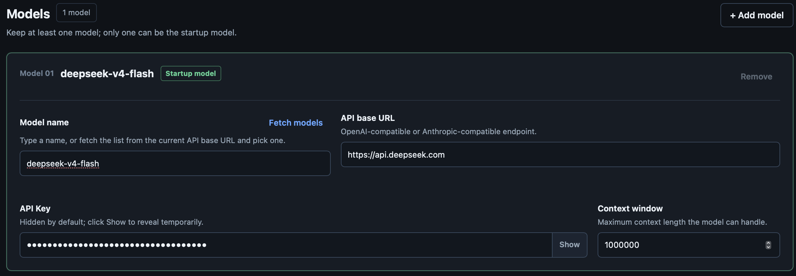

phi reads `~/.phi/config.yaml` (standard YAML). Environment variables override
it for one-off runs. `phi config` opens a full-screen terminal editor for the
same file — nothing is written until you save, and the previous file is kept
as `config.yaml.bak`.



```
phi config keys
  ↑↓ ←→      move / cycle a value        a   add a model
  ⏎          edit or open a picker       d   delete the focused row
  esc        close, or quit              f   fetch model ids from the provider
  ^s         save                        s   save        q  quit
```

An empty field means "not set", i.e. the value the loader would fill in; the
placeholder shows that value.

```yaml
# ~/.phi/config.yaml
models:
  - name: gpt-4o
    api: OpenAI             # OpenAI | OpenAIResponses | Anthropic | Gemini (empty → OpenAI-compatible)
    api_key: sk-...         # or set PHI_API_KEY
    base_url: https://api.openai.com/v1   # default; PHI_BASE_URL overrides
    context_window: 128000  # optional
    default: true           # the model used at startup; first entry wins if absent
  - name: claude-sonnet-4-20250514
    api: Anthropic          # required — no name/URL guessing
    api_key: sk-ant-...
    base_url: https://api.anthropic.com
    context_window: 200000
  - name: deepseek-flash    # built-in preset: base_url / context / thinking filled in
    api_key: sk-...
  - name: gemini-2.5-flash  # built-in preset (api: Gemini)
    api_key: ...
    think_level: high       # optional: off | minimal | low | medium | high | …

skill_path: ~/.phi/skills # where SKILL.md files are loaded from; "~/…" is expanded

agents:
  enabled: true           # default; set false to disable agent_* sub-agent tools
  models:                 # optional per-role defaults; omit → inherit parent model
    explore: cheap-model
    review: strong-model
    worker: coding-model

permissions:
  mode: interactive       # interactive | readonly | autopilot | headless-strict | allow-all
  bash:
    default: ask          # ask | allow | deny
    allow:
      - "go test ./..."
    deny:
      - "rm -rf *"
  rules:                  # extra rules; deny > ask > allow, always
    - kind: read
      resource: url
      decision: ask
      reason: external lookup needs approval
```

Other per-model keys: `max_tokens` (output limit, used as the compaction
summary cap), `think_enabled` / `think_level`, `preset` (bind an opaque
gateway route to a built-in preset), and `request_parameters` (per-model
request overrides). See
[Supported models](https://github.com/pulseaiclub/phi/blob/main/doc/models.md).

## Environment overrides

| Variable | Overrides |
| ---------------- | ------------------ |
| `PHI_API_KEY`    | `models[].api_key` (default model) |
| `PHI_MODEL`      | `models[].name` (default model) |
| `PHI_BASE_URL`   | `models[].base_url` (default model) |
| `PHI_SKILL_PATH` | `skill_path`       |
| `PHI_THINK_LEVEL` | `models[].think_level` (default model; `off` disables) |
| `PHI_PROMPT_HISTORY` | Composer prompt recall (`on` enables; off by default) |

Provider routing uses the explicit `api` field (`OpenAI` /
`OpenAIResponses` / `Anthropic` / `Gemini`). An empty `api` means
OpenAI-compatible `/chat/completions`; there is no name- or URL-based
guessing. Built-in presets (`deepseek-flash`, `gemini-2.5-flash`, …) fill in
`base_url` / `context_window` / thinking defaults, so only `name` and
`api_key` are required — see
[Supported models](https://github.com/pulseaiclub/phi/blob/main/doc/models.md).

## Recommended model: DeepSeek Flash

phi + DeepSeek Flash — the best pairing: grounded, low hallucination, cache hit
rates near 100%.

Measured data — 39 LLM rounds, same session: prompt **16k→40k**, hit rate
**95–100%** (avg **98.7%**).

| Round | Prompt tokens | Cached tokens | Cache hit |
| ---: | ---: | ---: | ---: |
| 1 | 16,176 | 15,872 | **98.1%** |
| 10 | 20,163 | 20,096 | **99.7%** |
| 20 | 27,604 | 26,624 | **96.4%** |
| 30 | 35,245 | 35,072 | **99.5%** |
| 39 | 39,794 | 39,552 | **99.4%** |

## Workspace layout

```
~/.phi/
├── config.yaml   # global configuration
├── bin/          # downloaded search tools (fd, ripgrep)
├── skills/       # SKILL.md skill directories
├── extensions/   # <name>/phi.yaml + compiled exec binaries
├── jobs/         # sub-agent job artifacts (meta, logs, result.md)
└── session/      # persisted sessions, one dir per working directory
    └── <encoded-cwd>/
```
