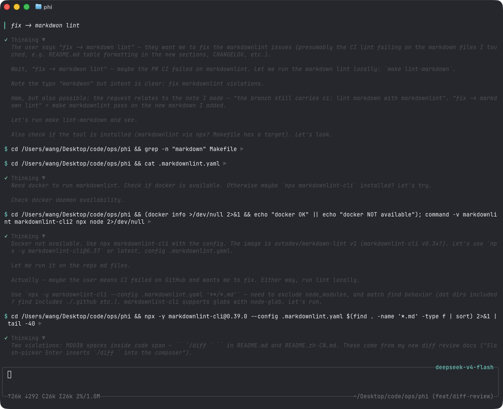
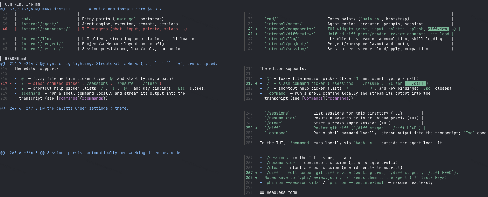

`phi` (or `phi tui`) starts the TUI: a chat transcript on top, an editor at
the bottom, and a footer with the current activity. When a newer release is
available, the footer shows a hint like `0.2.0 available · phi update`.

Assistant output is rendered as Markdown (CommonMark/GFM): headings, emphasis,
strikethrough, links, blockquotes, lists, task checkboxes, and tables are
styled with the active theme; fenced code blocks get a muted language caption
and per-language syntax highlighting. Structural markers (`#`, backticks,
`*`) are stripped.

## Editor

- `@` — fuzzy file mention picker (type `@` and start typing a path)
- `/` — slash command picker (`/sessions`, `/resume`, `/clear`, `/diff`)
- `?` — shortcut help picker (lists `/`, `!`, `@`, and key bindings; `Esc` closes)
- `!command` — run a shell command locally and stream its output into the
  transcript (see [Commands](#commands))
- `Ctrl+K` — command palette: settings → model / theme / permissions / agents
  (incl. per-role models), skills, extensions

## Keyboard shortcuts

| Key | Action |
| -------------- | ------------------------------- |
| `Ctrl+C` | Quit phi |
| `Esc` | Cancel the running agent / close pickers |
| `Ctrl+K` | Toggle the command palette |
| `Ctrl+A` | Jump to the start of the line |
| `Ctrl+E` | Jump to the end of the line |
| `Ctrl+U` | Clear the composer input, images, and skills |
| `Ctrl+Shift+C` | Copy the selected transcript text |

Themes: `Dark` (default), `Darcula`, `Pink`, and `Terminal`, switchable from
the palette under settings → theme.

## Commands

| Command | Description |
| ------------------ | --------------------------------------------- |
| `phi` / `phi tui` | Start the interactive TUI |
| `phi run -p "…"` | Run one agent loop headlessly |
| `phi update` | Download and install the latest GitHub release |
| `phi update --check` | Query the latest release without installing |
| `phi sessions list` | List persisted sessions for this directory |
| `/sessions` | List sessions for this directory (TUI) |
| `/resume <id>` | Resume a session by id or unique prefix (TUI) |
| `/clear` | Start a fresh empty session (TUI) |
| `/diff` | Full-screen git review (working tree) |
| `/diff staged` | Review staged changes |
| `/diff HEAD` | Review the last commit (`git show`) |
| `!command` | Run a shell command locally, stream output into the transcript; `Esc` cancels it |

In the TUI, `!command` runs locally via `bash -c` — outside the agent loop. It
doesn't count toward agent busy state, and the running command can be cancelled
with `Esc` without touching an in-flight agent turn.

## Diff review

`/diff` opens a full-screen git review inside the TUI — read the change, leave
line notes, then hand them to the agent without leaving the terminal.

| Command | What opens |
| --- | --- |
| `/diff` | Working tree (`git diff`) |
| `/diff staged` | Staged changes |
| `/diff HEAD` | Last commit (`git show`) |

The slash picker inserts `/diff ` with a trailing space (same pattern as
`/resume`); submit to open. Inside the overlay: `j` / `k` move, `s`
toggles side-by-side, `i` adds or edits a note, `x` deletes, `a` sends the
notes to the agent, `?` shows help, `q` / `Esc` close. Notes autosave under
`.phi/review.json`.
